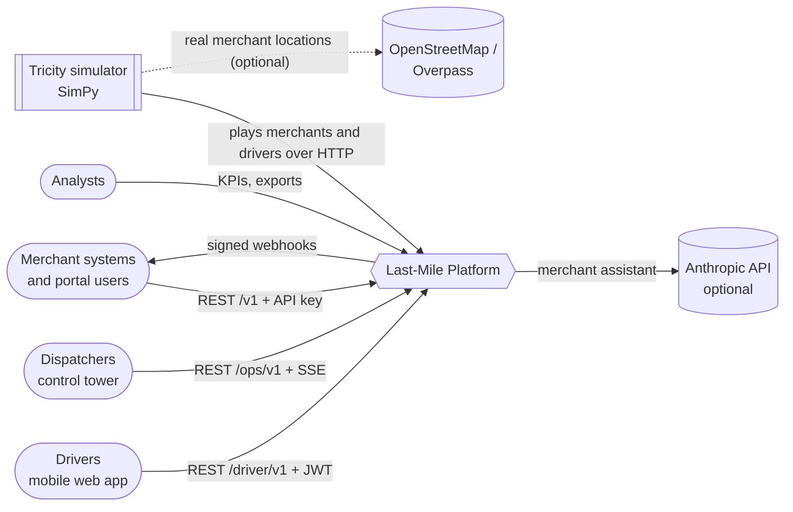
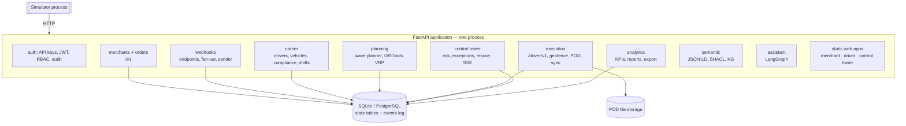
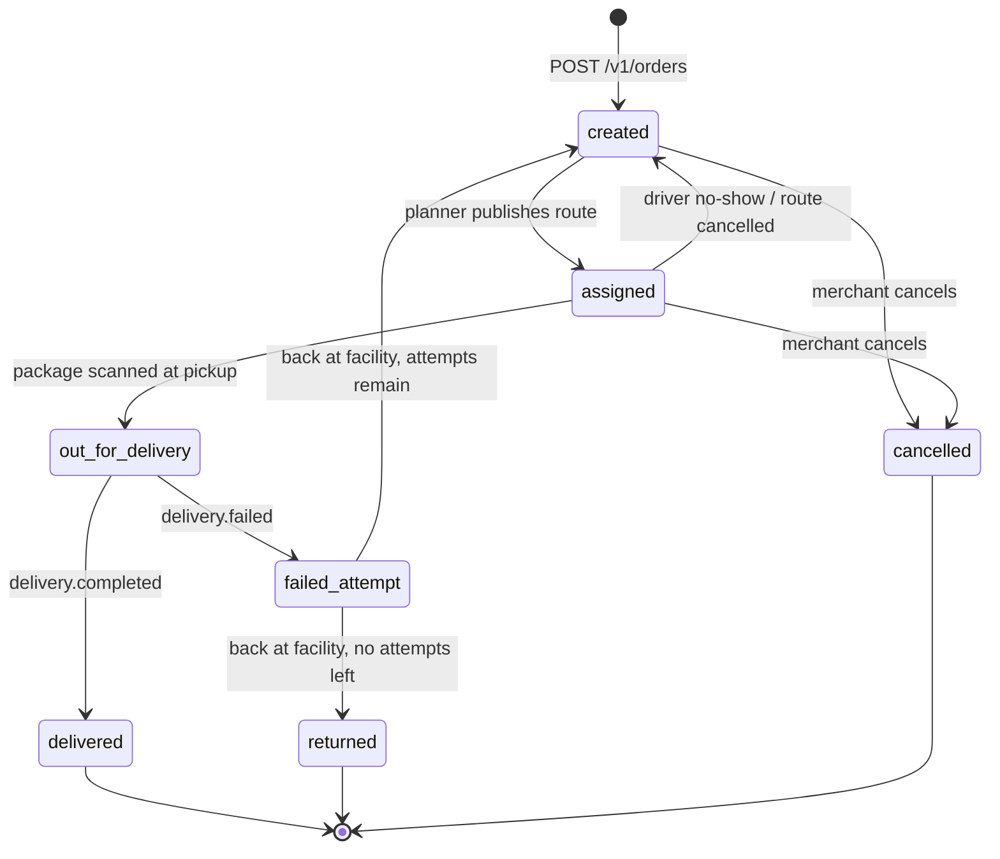
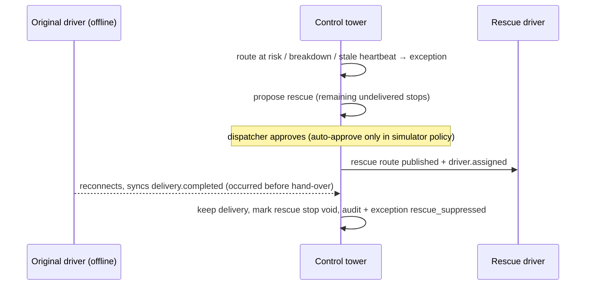

# Architecture

> **ELI5.** One program runs the whole delivery company. Inside it, separate "departments" (orders, planning,
> drivers, control room, reports, webhooks) each own their own data. Whenever a department changes something, it also
> writes a short note into a shared notebook — the **event log** — in the same breath, so a note can never be missing.
> Other departments read the notebook and react. A separate program, the **simulator**, pretends to be the city.

## 1. System context



## 2. Containers and modules



Background workers run as asyncio tasks inside the same process (see ADR-0002):

| Worker | Trigger | Does |
|---|---|---|
| Wave planner | every N simulated minutes per facility | builds routes for pending orders and available drivers |
| Webhook fan-out | new events | creates one delivery per subscribed endpoint (idempotent) |
| Webhook sender | due deliveries | signs and POSTs, records outcome, schedules retries |
| Route monitor | every simulated minute | ETA and risk per active route, stale heartbeats, no-shows |
| Batch worker | queued batches | processes bulk order rows through the same order service |
| Live feed | new events and locations | pushes updates to connected control-tower browsers (SSE) |

## 3. Event log (ADR-0004, ADR-0005)

```mermaid
sequenceDiagram
    participant M as Merchant
    participant API as Orders module
    participant DB as Database
    participant P as Planner
    participant W as Webhook fan-out
    M->>API: POST /v1/orders (Idempotency-Key)
    API->>DB: BEGIN; insert order + packages; insert event order.created; COMMIT
    API-->>M: 201 Created
    loop consumers poll by sequence number
        W->>DB: read events after my offset
        W->>DB: insert webhook_deliveries; advance offset (one transaction)
    end
    P->>DB: pending orders at facility (each wave)
    P->>DB: BEGIN; routes + stops + order status; events route.published, driver.assigned; COMMIT
```

Every event uses one envelope:

| Field | Meaning |
|---|---|
| `event_id` | UUIDv7, generated by the producer (device for driver events) — the idempotency key |
| `event_type`, `version` | e.g. `delivery.completed`, `1` |
| `occurred_at` | when it happened (device or simulated time) |
| `recorded_at` | when the platform stored it |
| `source` | `merchant-api`, `planner`, `driver-app`, `control-tower`, `simulator`, … |
| `order_id`, `package_id`, `route_id`, `stop_id`, `driver_id`, `vehicle_id`, `merchant_id`, `facility_id` | subjects (nullable) |
| `latitude`, `longitude` | where (nullable) |
| `metadata` | event-specific details |

The full catalog is in [`docs/events/asyncapi.yaml`](events/asyncapi.yaml).

## 4. Order lifecycle



Routes move `published → accepted → in_progress → completed` (or `cancelled`), and carry a separate risk state
`on_track | at_risk | late`. Stops move `pending → arrived → delivered | failed`, or `skipped` (cancelled order),
`transferred` (moved to a rescue route) and `void` (rescue leg suppressed because the original driver had already
delivered).

## 5. Rescue with suppression



## 6. Simulated time (ADR-0006)

The simulator calls `POST /internal/sim/start {epoch, speed}`. From then on the platform clock returns
`epoch + (wall_now − wall_start) × speed`; workers sleep in simulated minutes. The simulator runs SimPy against the
same formula, so both sides agree on "now" while a full day runs in minutes.

## 7. Deployment views

| Mode | Command | Database |
|---|---|---|
| Local demo | `make demo` | SQLite file in `var/` |
| Tests | `make test` | temporary SQLite |
| CI | GitHub Actions | SQLite and PostgreSQL 16 service container |
| Container | `docker/docker-compose.yml` | PostgreSQL 16 |

## 8. Decisions

See the [ADR index](adr/README.md).
